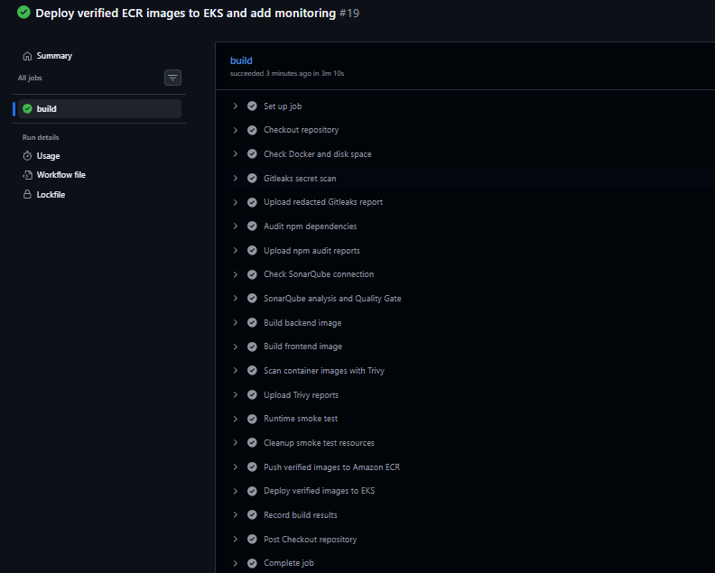
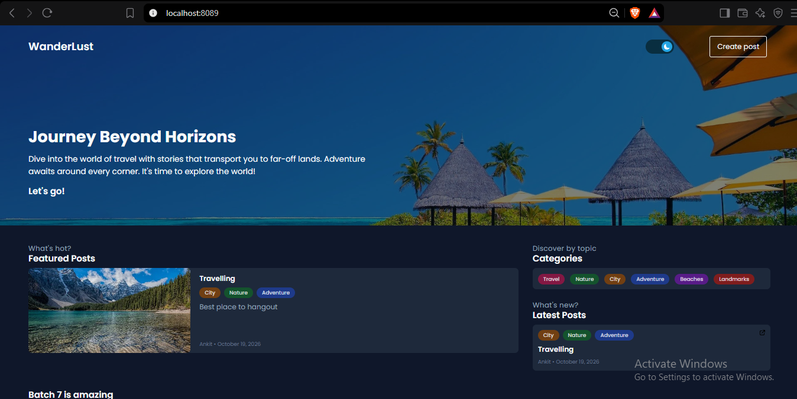
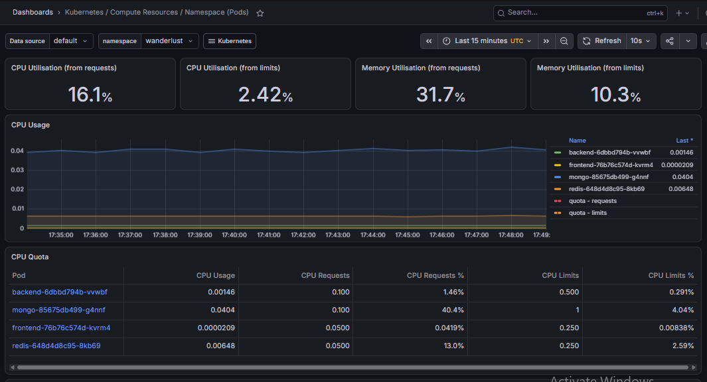
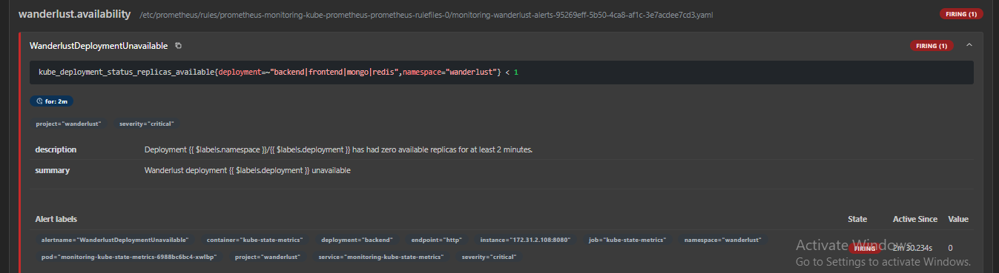

# Wanderlust DevSecOps Platform on AWS EKS

A hands-on portfolio project extending the existing Wanderlust application
with security checks, container hardening, automated deployment and monitoring.

## Tech stack

| Purpose | Tool |
|---|---|
| Source control | GitHub |
| CI/CD | GitHub Actions with a self-hosted EC2 runner |
| Containerization | Docker |
| Secret scanning | Gitleaks |
| Dependency audit | npm audit with documented exceptions |
| Code quality | SonarQube Community Build |
| Container vulnerability scanning | Trivy |
| Container registry | Amazon ECR |
| Application deployment | Amazon EKS, kubectl and Bash |
| Database | MongoDB with encrypted EBS gp3 storage |
| Cache | Redis |
| Monitoring | Prometheus and Grafana, installed using Helm |
| Storage permissions | EKS Pod Identity for EBS CSI |

Infrastructure was created using AWS Console and CLI in ap-southeast-2.
Terraform, Jenkins, Argo CD and OWASP Dependency-Check were not used
in this implementation.

## Pipeline

GitHub push → Gitleaks → dependency audit → SonarQube Quality Gate →
image builds → Trivy → container runtime smoke test → ECR →
deploy verified image digests to EKS → rollout verification.

See [.github/workflows/build-images.yml](.github/workflows/build-images.yml)
and [scripts/deploy/eks.sh](scripts/deploy/eks.sh).

## Verified results

- Run #19 build job completed successfully in 3m10s.
- Security and quality gates, runtime smoke tests and deployment passed.
- Backend, frontend, MongoDB and Redis were Running and available.
- Application health, website and existing post display were verified.
- Prometheus/Grafana monitoring and alert firing were demonstrated.
- Pre-publication Gitleaks scans reported zero findings across
  246 Git commits and the current working directory.

These are observed lab results, not a guarantee of security or availability.

## Configuration

- Application manifests: [kubernetes/eks](kubernetes/eks)
- Monitoring configuration: [monitoring](monitoring)
- Security exceptions: [docs/security](docs/security)

The runner authenticates to AWS using its EC2 IAM role.
Application credentials are referenced through Kubernetes Secrets.
Backend and frontend deployments use immutable ECR image digests.

Helm manages the monitoring stack; application deployment uses
Kubernetes manifests and the CI/CD shell script.

## Known limitations

- Single application and database replicas.
- Website demonstrated using local port-forward, without public HTTPS.
- Persistence restart, database restore and rollback drills not performed.
- External alert notifications not verified.
- Selected Sonar findings, empty-list UI and cache invalidation remain open.
- Cleanup completion has not yet been verified.

This is a portfolio lab, not a production-ready platform.

## Attribution

The original Wanderlust application belongs to its contributors.
This project adds DevSecOps, deployment, monitoring and troubleshooting work.
The existing [LICENSE](LICENSE) is retained.

The [preserved earlier README](docs/upstream/README-original.md) contains
historical project instructions and may describe a different toolchain.

<!-- wanderlust-evidence -->
## Project evidence

Alert screenshot: controlled failure test.
